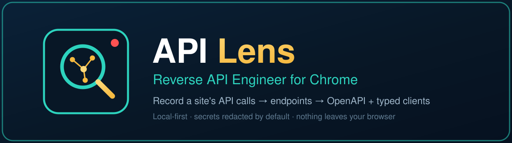

<p align="center">
  
</p>

<p align="center">
  
  
  
  
  
  
</p>

# 🔭 API Lens — Reverse API Engineer for Chrome

**Every website runs on APIs. API Lens shows you the ones your browser is already calling — and turns them into a client you own.**

The [reverse-api-engineer](https://github.com/kalil0321/reverse-api-engineer) idea, rebuilt as a Chrome extension: browse a site with recording on, and API Lens **collects the API calls the site makes**, groups them into endpoints, infers the contract, and **generates the client for you** — no HAR wrangling, no CLI, no model account required.

- 🎙 **Record per tab** — capture starts only when you press ● Record; the badge counts captures while it runs
- 🧩 **Endpoints, not noise** — calls group into templates (`/users/42` → `GET /users/{id}`) with inferred JSON schemas and detected auth
- 🧹 **Telemetry auto-filtered** — analytics, tracking and beacon calls are classified as noise, hidden by default, and always excluded from exports
- 📦 **One-click exports** — OpenAPI 3.1, typed clients in TypeScript / JavaScript / Python / Go, HAR 1.2, and per-endpoint curl
- 🔒 **Private by design** — no servers, no analytics, no account; secrets are redacted in exports unless you explicitly opt in

## How it works

| Piece | File | Job |
|---|---|---|
| Injector | `src/inject.js` | MAIN-world script (`document_start`) wrapping `fetch` / `XHR` / `sendBeacon`; reads responses from clones so page traffic is never disturbed |
| Bridge | `src/bridge.js` | ISOLATED-world relay between the page and the service worker |
| Service worker | `src/background.js` | Per-tab sessions (cap 300 entries/tab), red recording badge, debounced persistence, saved sessions |
| Brain | `src/core.js` | URL templating, JSON-schema inference/merging, endpoint grouping, auth detection, redaction, OpenAPI/TS/JS/Python/Go/HAR/curl generators — pure functions, unit-tested |
| UI | `src/popup.*`, `src/sidepanel.*` | Popup for quick record + export; side-panel workbench for endpoint inspection, schema trees, per-call detail |

Press ● Record on any tab and use the site like a user. API Lens captures every `fetch`, `XMLHttpRequest`, and `sendBeacon` call with headers, bodies, status, and timing — like the DevTools Network tab, but kept, organized, and turned into a contract: endpoint templates, required vs optional fields, and the auth style the site actually uses (bearer, basic, API key, or cookie).

## Exports

- **OpenAPI 3.1** spec (JSON)
- **TypeScript client** (`api_client.ts`) — typed
- **JavaScript client** (`api_client.js`)
- **Python client** (`api_client.py`, httpx-based, runnable `__main__` demo included)
- **Go client** (`api_client.go`, typed structs for object responses)
- **HAR 1.2** session file (feeds the original reverse-api-engineer CLI and other tooling)
- **curl** per endpoint, from the workbench

Generated clients are auth-aware: they carry an `AUTH_HEADERS` block matching the auth observed in traffic.

## ✨ AI Enhance (optional) — and exactly what it sends

The CLI tool's core is an LLM pass over the capture. API Lens offers the same step with **your own OpenRouter key** (stored only in your browser's local storage):

- It sends endpoint **shapes only** — endpoint names, field names and types, and counts. **Never credential values. Never body values.**
- The returned semantic function names and descriptions are applied to the endpoint list and to every generated client.
- You can give it a goal ("fetch the top stories"), like the CLI's agent-mode prompt.
- Without a key, everything still works — deterministically, offline.

## The deliberate difference: no hardcoded credentials

The CLI tool's generated scripts embed whatever live credentials the traffic contained, so they run with zero setup. API Lens **does not do that by default**: a file with your live session tokens in it is one accidental commit or share away from a hijacked account.

- Exports redact `Authorization`, cookies, API-key headers, and password/token fields (`•••redacted•••`) **by default**.
- Auth values in generated clients are **placeholders** by default.
- Tick **"include secrets in exports"** and you get the same runnable-with-zero-setup result — when *you* choose it, for a file *you* control.

## Install

**From this repo (unpacked):**

1. Download or clone this repository.
2. Open `chrome://extensions` → enable **Developer mode** → **Load unpacked** → select the repository folder (the one containing `manifest.json`).
3. Pin 🔭 API Lens to the toolbar.

Requires Chrome 116+ (Manifest V3, side panel API).

**Chrome Web Store:** submission prepared (listing, permission justifications and privacy policy are final); pending review once submitted.

## Demo (60 seconds, offline)

```sh
cd demo && python3 server.py   # → http://localhost:8077/
```

Open the demo page, press ● Record in the API Lens popup, click the demo buttons, then open the workbench. You'll see `/api/users/{id}`, `/api/search`, `/api/orders`, and `/api/login` grouped with inferred schemas — and the demo password redacted in every export.

## Privacy

API Lens operates no servers and collects nothing — no analytics, no telemetry, no accounts. Recording is per-tab and off until you press Record; sessions live in your browser's local storage (`chrome.storage.local`). The only outbound call the extension can ever make is the optional, user-triggered AI Enhance described above. Full policy: **[privacy-policy.html](privacy-policy.html)**.

This is an inspection tool for traffic **in your own browser** — the same visibility DevTools gives you. What you do with a site's API is between you and that site's terms.

## Tests

```sh
node --test tests/core.test.mjs   # 11 tests: URL templating, schema inference/merging,
                                  # redaction, auth detection, noise filtering,
                                  # OpenAPI / TS / JS / Python / Go / HAR generators
```

Current status: **unit tests 11/11 passing.**

## Honest limits

- **WebSocket frames aren't captured yet** — fetch/XHR/beacon only.
- Bodies are capped at **256 KB** each (flagged as truncated); binary bodies record size, not content.
- Inferred schemas are only as good as the traffic you generate — an endpoint you never trigger doesn't exist, and a field seen once may be optional in reality.
- Calls from cross-origin iframes are captured per-frame (`all_frames`), and the workbench groups everything under the tab.
- A request a page cancels mid-flight may appear with status `0`.

## Pricing

- **Free (beta)** — everything in this build, unlocked.
- **API Lens Pro — $12/month** planned: team session libraries, diffing between sessions, and one-click MCP tool export (feed endpoints straight into [Conductor](https://github.com/EdgeAgent/conductor) as tools).

No account. No telemetry. Nothing leaves your browser except an AI Enhance call you trigger with your own key.

## Changelog

**v1.1.0 (2026-11-06)** — Telemetry/noise filter (auto-classified, hidden by default, excluded from exports); AI Enhance with your own OpenRouter key (endpoint shapes only — no credential or body values ever sent); auth-aware clients in two new languages (JavaScript and Go generators join TypeScript and Python); saved sessions you can reload and re-export in any language.

**v1.0.0 (2026-11-06)** — First build: per-tab recording of fetch/XHR/beacon, endpoint templating, schema inference, auth detection, OpenAPI 3.1 + TypeScript/Python clients + HAR export, redaction on by default.

## Credits

Inspired by kalil0321's [reverse-api-engineer](https://github.com/kalil0321/reverse-api-engineer) (MIT). This is an original implementation of the same idea for the browser — no code copied. Sibling project: **Conductor**, which can import API Lens's OpenAPI exports and drive them as MCP tools.

## License

[MIT](LICENSE) © 2026 Kevin Doherty
